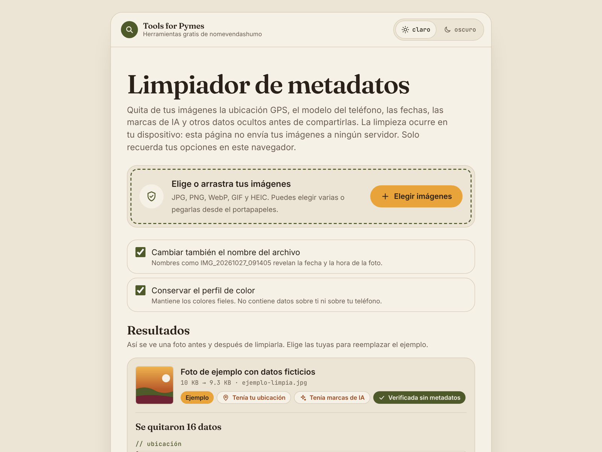
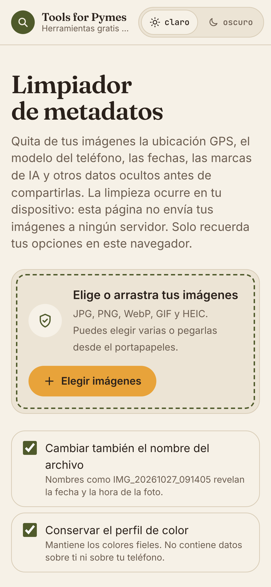

<div align="center">

# 🛡️ Limpiador de metadatos

**Quita de tus fotos la ubicación GPS, el modelo del teléfono, las fechas y las marcas de IA antes de compartirlas.**
Todo ocurre en tu navegador: tus imágenes nunca salen de tu dispositivo.

[**Probar la demo →**](https://danielherrodri.github.io/limpiador-metadatos/)

[](LICENSE)
[](https://danielherrodri.github.io/limpiador-metadatos/)


<picture>
  <source media="(prefers-color-scheme: dark)" srcset="docs/captura-oscuro.png">
  
</picture>

</div>

---

## ¿Por qué importa?

Cada foto que tomas con tu celular guarda datos que no se ven: **dónde la tomaste, con qué teléfono y a qué hora exacta**. Si vendes en línea y fotografías tus productos en casa o en tu taller, esos datos pueden llevar hasta tu puerta cuando mandas la foto como archivo por WhatsApp o correo, o cuando la subes a tu propia página.

Esta herramienta los quita en segundos, sin cuentas, sin instalar nada y sin subir tus fotos a ningún servidor.

## ✨ Qué hace

| | |
|---|---|
| 📍 **Ubicación** | Coordenadas GPS, altitud y GPS escondido en XMP. Te muestra en el mapa dónde se tomó la foto antes de quitarlo. |
| 📱 **Dispositivo** | Marca, modelo, número de serie, lente y software de edición. |
| 🕒 **Fechas** | Fecha de captura, de digitalización y de modificación, y zona horaria. |
| ✍️ **Autor** | Autor, derechos, descripción, comentarios y bloques IPTC. |
| ✨ **Marcas de IA** | Credenciales de contenido C2PA (ChatGPT, Gemini, Firefly…), la etiqueta IPTC «generada con IA» y los prompts que guardan Stable Diffusion, ComfyUI, Midjourney y similares. |
| 🗂️ **Datos escondidos** | Miniaturas ocultas, imágenes extra (MPF), bloques del fabricante y datos pegados al final del archivo. |

Además:

- **Sin pérdida de calidad.** En JPG, PNG, WebP y GIF solo se quitan los bloques de metadatos; los píxeles quedan intactos.
- **Verificación.** Cada imagen limpia se vuelve a analizar para confirmar que no quedó nada.
- **Conserva lo útil.** Mantiene la orientación (para que la foto no salga girada) y, si quieres, el perfil de color.
- **Renombra el archivo.** Nombres como `IMG_20261027_091405` también revelan la fecha.
- **Varias fotos a la vez:** elige, arrastra o pega desde el portapapeles.
- **Modo claro y oscuro**, y diseño adaptado a móvil.

<div align="center">

</div>

## 🖼️ Formatos

| Formato | Cómo se limpia |
|---|---|
| JPG / JPEG | Sin recomprimir: se quitan los segmentos APP, COM y C2PA |
| PNG | Sin recomprimir: se quitan los chunks de texto, eXIf, tIME y caBX |
| WebP | Sin recomprimir: se quitan los chunks EXIF, XMP y C2PA |
| GIF | Sin recomprimir: se quitan comentarios y bloques XMP |
| HEIC / AVIF | Se convierten a JPG o PNG (según lo que soporte tu navegador) |

## ⚠️ Lo que no puede quitar

- **Marcas de agua invisibles en los píxeles**, como SynthID de Google: no son metadatos, son parte de la imagen.
- **Lo que se ve en la foto:** placas, letreros, fachadas, reflejos o pantallas. Revísalo antes de publicar.

## 🔒 Privacidad

- Las imágenes se procesan en memoria, en tu navegador. No hay servidor, ni analítica, ni cookies.
- Lo único que se guarda (en `localStorage`) son tus opciones y el tema claro u oscuro.
- La página solo carga fuentes de Google Fonts; puedes quitarlas y usará las fuentes del sistema.

## 🚀 Úsala en tu equipo

Es un solo archivo HTML, sin dependencias ni compilación.

```bash
git clone https://github.com/danielherrodri/limpiador-metadatos.git
cd limpiador-metadatos
python3 -m http.server 8000
# abre http://localhost:8000
```

También puedes abrir `index.html` directamente o publicarlo en cualquier hosting estático (GitHub Pages, Cloudflare Pages, Netlify…).

## 🧩 Intégrala en tu proyecto

Toda la lógica de limpieza vive entre los comentarios `/*CORE-START*/` y `/*CORE-END*/` de `index.html`: JavaScript puro, sin DOM y sin librerías. Copia ese bloque y úsalo así:

```js
const bytes = new Uint8Array(await file.arrayBuffer());
const kind = sniff(bytes);            // 'jpeg' | 'png' | 'webp' | 'gif' | 'heic' | 'avif' | 'other'

const { out, F } = stripBytes(bytes, kind, { keepIcc: true });
// out: Uint8Array con la imagen limpia
// F:   lista de lo que se encontró → [{ cat: 'ubicacion', label: 'Coordenadas GPS', value: '19.43260, -99.13320' }, …]

const limpia = new Blob([out], { type: 'image/' + kind });
```

- `stripBytes` lanza un error con HEIC, AVIF y formatos que no reconoce; en ese caso conviene redibujar la imagen en un `<canvas>` (la interfaz lo hace con `viaCanvas`).
- Categorías de `F`: `ubicacion`, `ia`, `dispositivo`, `fecha`, `autor`, `otros` y `conservado` (lo que se mantuvo a propósito, como la orientación o el perfil de color).
- Para verificar, vuelve a pasar `out` por `stripBytes`: si solo quedan elementos `conservado`, la imagen está limpia.

## 🛠️ Stack

HTML, CSS y JavaScript sin frameworks. Lectura y escritura de EXIF/TIFF, segmentos JPEG, chunks PNG y WebP y bloques GIF hechas a mano, byte por byte.

## 🤝 Contribuir

¿Encontraste una foto que no se limpia bien o un metadato que falta? Abre un [issue](https://github.com/danielherrodri/limpiador-metadatos/issues) (sin adjuntar fotos con datos personales) o manda un pull request.

## 📄 Licencia

[MIT](LICENSE): puedes usarla, copiarla, modificarla e incluirla en tus proyectos, también comerciales, sin pagar nada. Solo conserva el aviso de copyright y la licencia.

---

<div align="center">

Hecha por **Daniel Rodríguez Herrera** como parte de **Tools for Pymes**, las herramientas gratis de [nomevendashumo.com](https://www.nomevendashumo.com).
Más proyectos en [danielherrodri.github.io](https://danielherrodri.github.io/).

</div>
